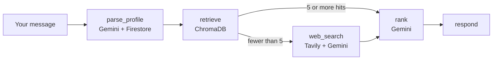

Scholarship Sahaya

**Tell it who you are. It finds the scholarships you can actually apply for.**


---

## The problem

India has thousands of scholarships. Central, state, private, corporate, trust-funded. The information is scattered across dozens of portals, the eligibility rules are buried in PDFs, and deadlines quietly pass. Students who need the money most are often the ones with the least time to dig for it.

Anveshan AI (also known as Scholarship Sahaya is an agentic system that does the digging. You describe yourself in plain language. It figures out your profile, searches what it already knows, goes to the web when it needs fresh results, checks each scholarship against your situation, and hands back a ranked shortlist with reasons, deadlines, documents and apply links.

## What it does

- **Understands you from free text.** Say "B.E. CSE student from Karnataka, OBC, family income 3 lakh" and it extracts a structured profile. No forms.
- **Remembers you.** Profiles are saved in Firestore, so follow-up questions build on what it already knows.
- **Searches smart.** It checks its own ChromaDB knowledge base first. Only when local results are thin does it call the web, which keeps things fast and cheap.
- **Learns as it goes.** Every new scholarship it finds is structured, embedded and stored, so the next student with a similar profile gets a better first answer.
- **Judges eligibility, not just relevance.** Each scholarship gets a fit score, a yes/maybe/no verdict, a reason, and a list of documents you will likely need.
- **Gives you the source.** Every result links back to where it came from, so you can verify before you apply.

## How it works



| Step | What happens |
|------|--------------|
| `parse_profile` | Gemini pulls education level, course, state, category, income and more out of your message, then merges it with any saved profile. |
| `retrieve` | Semantic search over scholarships already stored in ChromaDB. |
| `web_search` | Tavily fetches fresh results. Gemini turns them into structured scholarship records. New ones are embedded into Chroma and saved to Firestore. |
| `rank` | Gemini scores every candidate against your profile using only the stated eligibility, drops the ones you do not qualify for, and lists the documents needed. |
| `respond` | A clean, ranked shortlist with fit score, reason, deadline, documents and apply link. |

## Tech stack

| Layer | Tool |
|-------|------|
| Agent orchestration | LangGraph |
| LLM and embeddings | Google Gemini |
| Vector store | ChromaDB |
| Live web search | Tavily |
| Persistence | Firebase Firestore |
| Validation | Pydantic (structured outputs) |

## Project structure

```
anveshan-ai/
├── main.py            # CLI entry point
├── graph.py           # LangGraph nodes, routing and graph definition
├── services.py        # Gemini, ChromaDB, Tavily and Firestore clients
├── schemas.py         # Pydantic models and graph state
├── requirements.txt
└── .env.example
```

## Quickstart

**1. Clone and install**

```bash
git clone <your-repo-url>
cd anveshan-ai
python -m venv .venv && source .venv/bin/activate
pip install -r requirements.txt
```

**2. Add your keys**

```bash
cp .env.example .env
```

Then fill in `.env`:

| Variable | Required | Notes |
|----------|----------|-------|
| `GOOGLE_API_KEY` | Yes | Gemini API key from Google AI Studio |
| `TAVILY_API_KEY` | Yes | From tavily.com |
| `GEMINI_MODEL` | No | Defaults to `gemini-2.5-flash` |
| `GOOGLE_APPLICATION_CREDENTIALS` | No | Path to a Firebase service account JSON. Without it, the app runs fine but skips profile and scholarship persistence. |

**3. Run it**

```bash
python main.py "B.E CSE student from Karnataka, OBC, family income 3 lakh" --user myles
```

Or run `python main.py` with no arguments and it will ask you.

## Example output

The format looks like this (content below is illustrative, your results come from live search):

```
Profile used: education_level: UG, course: B.E. Computer Science, state: Karnataka, category: OBC, annual_family_income_inr: 300000

1. <Scholarship name>  (fit 88/100, eligible: yes)
   Why: Matches your category, course level and income bracket.
   Deadline: <date from source>
   Documents: Income certificate, caste certificate, previous marksheet
   Apply: <official link>

Always confirm eligibility and deadlines on the official portal before applying.
```

## Honest limitations

This is a discovery tool, not an authority. Worth knowing:

- **Eligibility is judged from what the sources say.** If a page is vague or outdated, the verdict will be too. That is why unclear cases come back as "maybe" instead of a confident yes.
- **Web data can be stale.** Deadlines change. Always confirm on the official portal.
- **LLM extraction can make mistakes.** The prompts tell Gemini not to invent details and to leave unknown fields empty, but you should still verify the source link.
- **Coverage depends on what Tavily surfaces.** The knowledge base grows with use, but it starts empty.
- **No evaluation numbers yet.** There is no benchmark here, so no accuracy claims are made.

## Roadmap

- [ ] Multilingual input and output (Hindi, Kannada and other Indian languages)
- [ ] Voice input
- [ ] FastAPI backend and a simple web UI
- [ ] Deadline reminders
- [ ] Curated ingestion from official portals alongside web search
- [ ] An eval set to measure eligibility-matching quality

## Contributing

Ideas, issues and pull requests are welcome. If you know a scholarship source that should be indexed, open an issue.

## Author

Built by **Vanshika Sharma**.

---

*Built so no student misses a scholarship they deserved.*
